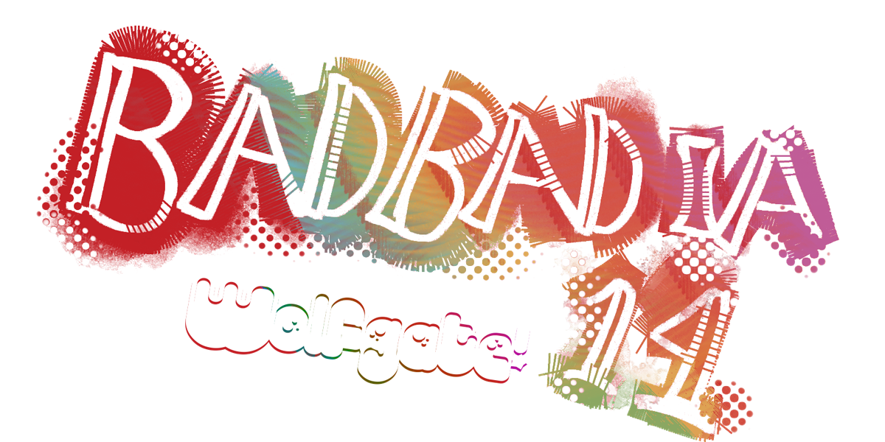

<!-- WOLFGATE(Branding) START: rebrand from Monolith to Wolfgate -->

Badbadia is a fork of [Wolfgate](https://github.com/VanguardControl/Wolfgate), Wolfgate is a fork of [Monolith](https://github.com/Monolith-Station/Monolith), itself a fork of [Frontier Station 14](https://github.com/new-frontiers-14/frontier-station-14), running on the [Robust Toolbox](https://github.com/space-wizards/RobustToolbox) engine written in C#.

This is the primary repo for Badbadia's fork of Wolfgate.

You cannot create content for us, but you can always for our edits. (we highly suggest not doing so as it only fits our needs)
<!-- WOLFGATE END -->

## Links

<!-- WOLFGATE(Branding): dropped Monolith's Discord link -->
[Steam](https://store.steampowered.com/app/1255460/Space_Station_14/)

<!-- WOLFGATE(Branding): link to the contributor guidelines -->
[Guide to Modularisation and Wolfgate](Wolfgate%20Guidelines.md)

## Contributing

<!-- WOLFGATE(Branding) START: rebrand contributing section -->
Contributions are welcome. Wolfgate-specific code lives in `_WF` folders, and edits to upstream files are marked with `// WOLFGATE` comments so they are easy to find when merging from Monolith.

We are not accepting translations on this repository.
<!-- WOLFGATE END -->

## License

<!-- WOLFGATE(Branding) START: reworded license section for Wolfgate branding -->
See the REUSE headers for detailed licensing information for each file. The work as a whole is licensed under the GNU Affero General Public License version 3.0.

Licensing inherited from Wolfgate, Monolith, and Frontier:

- Original code contributed to the Monolith codebase after 04d8ce483f638320d1b85a7aaacdf01442757363 is under the Mozilla Public License version 2.0 with Exhibit B removed. See `LICENSES/MPL-2.0.txt`.
- Content contributed after commit 2fca06eaba205ae6fe3aceb8ae2a0594f0effee0 is licensed under the GNU Affero General Public License version 3.0, unless otherwise stated. See `LICENSES/AGPL-3.0-or-later.txt`.
- Content contributed before commit 2fca06eaba205ae6fe3aceb8ae2a0594f0effee0 is licensed under the MIT license, unless otherwise stated. See `LICENSES/MIT.txt`.

[2fca06eaba205ae6fe3aceb8ae2a0594f0effee0](https://github.com/new-frontiers-14/frontier-station-14/commit/2fca06eaba205ae6fe3aceb8ae2a0594f0effee0) was pushed on July 1, 2024 at 16:04 UTC.

Most assets are licensed under [CC-BY-SA 3.0](https://creativecommons.org/licenses/by-sa/3.0/) unless stated otherwise. Assets have their license and copyright in the metadata file. [Example](https://github.com/space-wizards/space-station-14/blob/master/Resources/Textures/Objects/Tools/crowbar.rsi/meta.json).

Some assets are licensed under the non-commercial [CC-BY-NC-SA 3.0](https://creativecommons.org/licenses/by-nc-sa/3.0/) or similar non-commercial licenses and will need to be removed if you wish to use this project commercially.
<!-- WOLFGATE END -->

<!-- WOLFGATE START: credit the Starlight licence and the Goonstation-derived reactor -->
Code under `_Starlight` folders, and the Starlight-derived parts of `_FarHorizons`, was contributed to Starlight between 2024-11-04 and 2026-02-28 and is under the Starlight License (Wolfgate's own edits there are marked `WOLFGATE` and are under the AGPL), a modified MIT license that requires attributing the Starlight project as its source: https://github.com/ss14Starlight/space-station-14. See `LICENSES/LicenseRef-Starlight.txt`.

The nuclear reactor code under `_FarHorizons/Power/Generation/FissionGenerator` is ported from Goonstation and is labelled MIT, following HardLight commit b602e8d485, which records permission from jhrushbe, rottenheadphones and taydeo. Assets whose metadata names Goonstation as their source are under [CC-BY-NC-SA 3.0](https://creativecommons.org/licenses/by-nc-sa/3.0/).
<!-- WOLFGATE END -->
